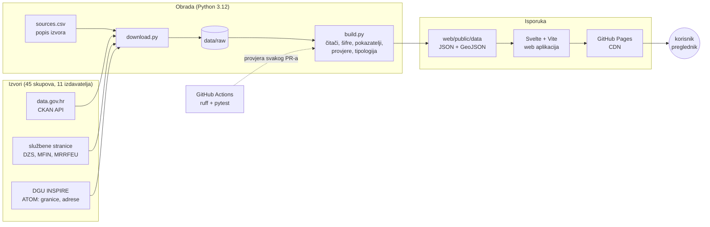

# Kompas Hrvatske – tehnička arhitektura

Ovaj dokument opisuje kako je rješenje složeno, na kojim standardima počiva, kako se može
povezati s postojećim javnim informacijskim sustavima te koji su tehnički, organizacijski i
pravni preduvjeti za njegovo korištenje i održavanje.

## 1. Pregled

Kompas Hrvatske je **statička web aplikacija bez vlastitog poslužitelja**. Sav posao s
podacima obavi se unaprijed: Python obrada preuzme otvorene podatke preko API-ja Portala
otvorenih podataka i službenih stranica izdavatelja, očisti ih, poveže po službenim šiframa
i zapiše u male JSON i GeoJSON datoteke. Preglednik zatim samo učita te datoteke i prikaže
ih na karti.



| Sloj | Tehnologija | Što radi |
| --- | --- | --- |
| Izvori | CKAN Action API (data.gov.hr), izravne poveznice, DGU ATOM | 45 korištenih skupova: 35 s Portala, 10 dopunskih izvora tijela javne vlasti |
| Preuzimanje | `pipeline/download.py`, `requests` | čita `data/sources.csv`, za skupove s Portala pita CKAN API (`package_show`), preuzima samo nove datoteke, vodi dnevnik |
| Obrada | pandas, GeoPandas, python-calamine, pdfplumber, scikit-learn | čitači za XLSX/XLS/CSV/PDF/ZIP/GML, usklađivanje naziva i šifri, prostorni spojevi, geokodiranje, 37 pokazatelja, javna nabava (OCDS) i graf veza, EU pozivi, vremenski nizovi, rangovi, tipologija (k-means) |
| Kontrola kvalitete | provjere u `build.py`, pytest (83 testa), ruff, GitHub Actions | obrada staje ako zbrojevi ne odgovaraju izvoru; testovi provjeravaju kod i oblik izlaznih datoteka kod svakog pull requesta |
| Podatkovni sloj | statične datoteke u `web/public/data/` (≈18 MB, većina se učitava tek po potrebi) | ugovor između obrade i sučelja, opisan u [format-podataka.md](format-podataka.md) |
| Sučelje | Svelte 5, Vite, Mapbox GL JS, Chart.js, Fuse.js | karta s razinama Država → Županija → Grad, paneli, grafovi, pretraga, priče |
| Objava | GitHub Actions + GitHub Pages | svaki spoj u `main` automatski gradi i objavljuje demo |

## 2. Obrada podataka

Obrada je skup Python modula u `pipeline/`, jedan modul po zadatku. Tri naredbe iz praznog
repozitorija daju sve izlazne datoteke (provjereno na svježem klonu):

```powershell
python pipeline/download.py   # ~1 GB sirovih podataka u data/raw/
python pipeline/build.py      # 1–2 minute, s provjerama
python -m pytest              # 83 testa
```

Ključne odluke:

- **Jedan popis izvora** (`data/sources.csv`): id, izdavatelj, poveznica, dozvola, datum
  preuzimanja. Iz njega nastaju dokumentacija izvora i navođenje izvora u aplikaciji, pa se
  ne mogu razići.
- **Jedan katalog pokazatelja** (`pipeline/pokazatelji.py`): naziv, jedinica, razine,
  izvor i objašnjenje za korisnika. Novi pokazatelj = jedan unos u katalogu i čitač izvora;
  sučelje ga prikazuje bez promjene koda.
- **Spajanje po službenim šiframa**, ne po nazivima: županije `01`–`21`, gradovi i općine
  5-znamenkastom šifrom iz Registra prostornih jedinica DGU-a. Izvori bez šifre usklađuju se
  po nazivu unutar županije (556/556 u svakom skupu).
- **Provjere koje zaustavljaju obradu**: 21 županija, 556 gradova i općina, zbroj županija =
  država, zbrojevi proračuna = zbirni listovi Ministarstva financija. Greška u izvoru ne može
  tiho završiti na karti.
- **Veliki podaci bez velikog stroja**: registar adresa DGU-a (2,6 GB GML, 1,68 milijuna
  kućnih brojeva) čita se strujanjem, bez učitavanja u memoriju, a rezultat se sprema u
  predmemoriju.
- **Strojno učenje**: tipologija svih 556 gradova i općina (k-means nad pet standardiziranih
  obilježja iz četiri izvora) i „najsličniji po profilu”. Opis u
  [podaci-dokumentacija.md](podaci-dokumentacija.md#63-tipologija-gradova-i-općina-strojno-učenje).

Detaljan opis svih koraka, izvora i provjera: [podaci-dokumentacija.md](podaci-dokumentacija.md).

## 3. Podatkovni sloj (ugovor obrade i sučelja)

| Datoteka | Sadržaj | Učitava se |
| --- | --- | --- |
| `meta.json` | teme, katalog pokazatelja (naziv, jedinica, razdoblje, objašnjenje), izvori s dozvolom i datumom, tipologija | na početku |
| `drzava.json`, `zupanije.json` | pokazatelji, rangovi i slična područja | na početku |
| `zupanije.geojson` | granice županija (DGU, pojednostavljene za web) | na početku |
| `jls.json` | 556 gradova i općina: pokazatelji, rangovi, tip, slični | pri prvom ulasku u županiju |
| `jls/<šifra>.geojson` | granice gradova i općina jedne županije | pri ulasku u tu županiju |
| `proracuni.json` | proračuni 2019.–2025. i rashodi po namjeni | uz temu Novac |
| `nizovi.json` | vremenski nizovi za grafove ostalih tema (stanovništvo, nezaposlenost, dohodak, porez, kupoprodaje, imovina) | uz temu Ljudi, Porezi ili Imovina |
| `nabava.json` | najveći dobavljači i veze prema drugim gradovima i općinama (graf veza) | uz temu Nabava |
| `eu-pozivi.json` | planirani EU pozivi za 2026. s ulogom gradova, općina i županija | uz temu Novac |
| `en.json` | engleski tekstovi podataka (pokazatelji, teme, tipologija, nizovi, županije, napomene) | kad korisnik odabere EN |
| `tocke/eu-projekti.geojson` | EU projekti po gradovima i općinama | uz gumb „EU projekti” |
| `gradovi/…` | Zagreb po četvrtima (pokazatelji, slojevi, 3D zgrade) i Rijeka | pri otvaranju gradskog prikaza Zagreba ili Rijeke |
| `svemir.geojson` | maska oko hrvatskog kopna za prikaz „Hrvatska u svemiru” | na početku |

Oblik je verzioniran (`verzija_formata` u `meta.json`): promjena ključa povećava verziju, a
test `tests/test_podaci.py` na GitHubu odbija datoteke koje ne odgovaraju dogovoru.

## 4. Sučelje

- **Stanje u URL-u**: svaki pogled ima svoju poveznicu (npr.
  `#/jls/01333?tema=novac&mjera=po-stanovniku`), pa se konkretan grad i tema mogu poslati,
  ugraditi ili otvoriti iz drugog sustava.
- **Raspored**: na širokom ekranu dvije bočne trake koje se mogu zatvoriti (lijevo grafovi,
  desno brojke i usporedbe) i karta u sredini; na mobitelu paneli se slažu ispod karte.
- **Gradski prikaz** Zagreba i Rijeke otvara se sam pri odabiru grada (satelit, četvrti,
  filtri). Opis karte: [karta.md](karta.md).
- **Karta i paneli ne zovu jedni druge**: oboje čitaju zajedničko stanje (`src/state.js`),
  pa se karta može zamijeniti bez diranja panela i obrnuto.
- **Navođenje izvora uz svaki broj**: izdavatelj, naziv skupa, razdoblje, datum preuzimanja,
  poveznica i dozvola, iz `meta.json`.
- **Pristupačnost**: grafovi imaju skrivenu tablicu za čitače zaslona, sve radi tipkovnicom,
  poštuje se postavka „smanjeno kretanje”, a raspored se prilagođava mobitelu.

Opis sučelja: [sucelje.md](sucelje.md) i [web/README.md](../web/README.md).

## 5. Standardi i interoperabilnost

| Područje | Standard | Gdje |
| --- | --- | --- |
| Pristup podacima | CKAN Action API (data.gov.hr), HTTP/HTTPS | `download.py` |
| Javna nabava | Open Contracting Data Standard (OCDS), JSON Lines | `nabava.py` |
| Prostorni podaci | INSPIRE (teme Upravne jedinice i Adrese), GML 3.2, ATOM usluga preuzimanja | granice, adrese |
| Koordinatni sustavi | ETRS89-LAEA (EPSG:3035, sustav INSPIRE usluga DGU-a) → WGS84 (EPSG:4326) za web | `granice.py`, `adrese.py` |
| Razmjena podataka | GeoJSON (RFC 7946), JSON, CSV (UTF-8) | `web/public/data/` |
| Šifre područja | službene šifre županija `01`–`21`; šifre gradova i općina iz Registra prostornih jedinica DGU-a | sve tablice |
| Statistička podjela | NUTS 2021 (HR NUTS 2 i županije) | BDP i bruto dodana vrijednost |
| Proračuni | računski plan proračuna (razredi 3, 4, 6, 7, skupina 63) i funkcijska klasifikacija COFOG | `proracuni.py` |
| Javne financije | ESA 2010 (saldo i dug opće države, HNB) | pokazatelji države |
| Datumi i brojevi | ISO 8601 u podacima, hrvatski zapis (`1.234,5`) u sučelju | `meta.json`, `format.js` |
| Dozvole | Otvorena dozvola (NN 67/17), CC BY 4.0, uz navođenje izvora | `sources.csv`, sučelje |

## 6. Integracijski potencijal

Rješenje je napravljeno tako da se uz razumne prilagodbe uključi u postojeće javne sustave:

1. **Portal otvorenih podataka (data.gov.hr).** Već koristi njegov API. Izlazne datoteke
   (`meta.json`, `zupanije.json`, `jls.json`, `proracuni.json`) su gotov izvedeni skup
   podataka: povezani pokazatelji svih županija, gradova i općina sa šiframa, pa se mogu
   objaviti natrag na Portal i koristiti u drugim aplikacijama bez ponavljanja obrade.
2. **Automatsko osvježavanje.** `download.py` za svaki skup čita metapodatke s Portala i
   prepoznaje premještene skupove. Zakazani GitHub Actions posao (npr. mjesečno) može
   pokrenuti preuzimanje i obradu, a provjere spriječe objavu ako se izvor promijeni na
   neočekivan način.
3. **Ugradnja u stranice gradova, općina i ministarstava.** Svaki pogled ima stalnu
   poveznicu, pa grad može na svojoj stranici povezati ili ugraditi (iframe) svoj profil.
4. **Zamjena izvora boljim sučeljima.** Kad izdavatelj objavi isti podatak preko API-ja
   (npr. proračune Ministarstva financija na Portalu ili tablice DZS-a u strojno čitljivom
   obliku umjesto PDF-a), mijenja se samo jedan čitač u `citaci.py`; ostatak obrade i
   sučelje ostaju isti.
5. **Javna nabava.** Registar ugovora čita se u standardu OCDS, koji koriste i drugi
   europski registri; isti čitač radio bi i nad izravnim izvozom iz EOJN-a ili TED-a.
6. **Prostorni sustavi.** Granice su službene DGU granice u WGS84 i GeoJSON-u, a šifre su
   iste kao u Registru prostornih jedinica, pa se podaci izravno spajaju s drugim INSPIRE
   uslugama (npr. WMS/WFS DGU-a) i GIS alatima.
7. **Nove teme.** Novi pokazatelj ili izvor dodaje se jednim unosom u `sources.csv` i
   `pokazatelji.py` te čitačem; karta, legenda, paneli, objašnjenja i navođenje izvora rade
   automatski.

## 7. Preduvjeti

### Tehnički

- **Hosting**: bilo koji poslužitelj statičnih datoteka ili CDN (sada GitHub Pages);
  nema baze podataka ni pozadinskog servisa, pa nema ni troškova poslužitelja ni površine
  za napad.
- **Podloga karte**: Mapbox (besplatno do 50.000 učitavanja karte mjesečno, javni token
  ograničen na domenu). Mapbox GL JS je jedina komponenta koja nije otvorenog koda;
  **MapLibre GL JS** je otvorena zamjena s gotovo istim API-jem, a podloga se može zamijeniti
  otvorenom (OpenStreetMap) ili uslugama DGU-a.
- **Obrada**: Python 3.12, oko 1 GB prostora za sirove podatke, 1–2 minute rada; web:
  Node.js LTS za build.

### Organizacijski

- **Vlasnik i održavatelj** (npr. tijelo zaduženo za Portal ili udruga gradova i općina)
  koji pokreće osvježavanje i prati upozorenja provjera.
- **Ritam osvježavanja** prema izvorima: proračuni i porez na dohodak godišnje, EU popisi
  operacija tromjesečno, nezaposlenost i inflacija mjesečno.
- **Suradnja s izdavateljima**: provjere su do sada otkrile greške u izvorima (npr. zbirni
  listovi proračuna, tipfeleri u nazivima, neispravne poveznice); trajno rješenje je
  povratna informacija izdavatelju i dopuna metapodataka (npr. dozvole skupova DZS-a).

### Pravni

- **Dozvole izvora** poštuju se pojedinačno ([izvori-podataka.md](izvori-podataka.md)):
  Otvorena dozvola i CC BY 4.0 uz navođenje izvora; za skupove bez navedene dozvole navodi se
  izvor, bez tvrdnje o Otvorenoj dozvoli, prema odgovoru organizatora od 29. 10. 2026.
- **Navođenje izvora** je ugrađeno u aplikaciju (uz svaki broj i za granice DGU-a).
- **Osobni podaci** se ne obrađuju: koriste se zbirni podaci i javno objavljeni popisi
  (npr. korisnici EU projekata, koje se prema Uredbi (EU) 2021/1060 obvezno objavljuju).
- **Licenca koda** je MIT; podaci zadržavaju dozvolu izdavatelja.

## 8. Ograničenja i daljnji razvoj

| Ograničenje danas | Daljnji razvoj |
| --- | --- |
| Osvježavanje se pokreće ručno | zakazani GitHub Actions posao i obavijest kad se izvor promijeni |
| Pokazatelji gradova i općina ograničeni su na ono što izdavatelji objavljuju po JLS (npr. plaće i nezaposlenost samo po županijama) | novi izvori kad budu objavljeni (DZS po gradovima, HZZ po JLS) |
| Vremenski nizovi samo za proračune | nizovi za sve pokazatelje i usporedba kroz godine na karti |
| Gradski prikaz samo za Zagreb i Rijeku | isti obrazac za ostale gradove koji objavljuju podatke po četvrtima |
| Podloga karte ovisi o Mapboxu | prelazak na MapLibre i otvorenu podlogu |
| Izlazni podaci dostupni samo kao datoteke u repozitoriju | objava kao skup podataka na Portalu i jednostavan javni API |
