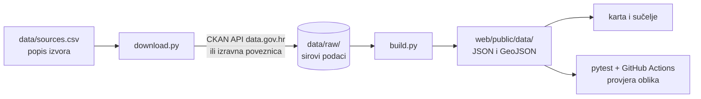

# Kompas Hrvatske – podatkovni dio

**Tehnička dokumentacija obrade podataka**
Autor: David Jašek (uloga: podaci) · Stanje: 29. 10. 2026.
Datathon Portala otvorenih podataka (MPUDT), izazov C: Gospodarstvo i učinkovito upravljanje

Ovaj dokument opisuje sve što je napravljeno u podatkovnom dijelu projekta: koje podatke
koristimo i pod kojim uvjetima, kako se preuzimaju, čiste i povezuju, kako nastaju datoteke
za kartu i sučelje te kako se provjerava da su brojke točne. Kartu (Boro) i sučelje (Rafael)
dokumentiraju njihovi dijelovi; dogovoreni oblik datoteka između nas opisan je u
[format-podataka.md](format-podataka.md).

## 1. Sažetak

| | |
| --- | --- |
| Korišteni skupovi podataka | **41** (35 s Portala otvorenih podataka, 6 dopunskih izvora tijela javne vlasti) |
| Izdavatelji | 10 (DZS, DGU, Porezna uprava, HNB, HBOR, Ministarstvo financija, Ministarstvo regionalnoga razvoja i fondova EU, MPUDT, Grad Zagreb, Grad Rijeka) |
| Pregledani skupovi ukupno | 71 (ostali su pregledani i opisani, ali se ne koriste ili su neispravni na izvoru) |
| Pokazatelji na karti | **32** na razinama Država, Županija i Grad/općina, u 4 teme (Ljudi, Novac, Porezi, Imovina) |
| Područja | Hrvatska, 21 županija, **556 gradova i općina** (svi), 17 gradskih četvrti Zagreba |
| Gradski prikaz | Zagreb: 13 pokazatelja po četvrtima, 8 slojeva na karti, 3D zgrade; Rijeka: proračun, 1.295 prostora u zakupu na karti |
| Granice | službene granice Državne geodetske uprave (INSPIRE), pojednostavljene za web |
| Kontrola kvalitete | automatske provjere u svakom pokretanju obrade, 44 testa, provjera na GitHubu kod svakog pull requesta |
| Ponovljivost | cijela obrada iz praznog repozitorija s tri naredbe; provjereno na svježem klonu |

Sve je napisano u Pythonu (3.12) isključivo s alatima otvorenog koda: pandas, geopandas,
shapely, python-calamine, pdfplumber, requests, pytest i ruff.

## 2. Kako obrada radi



1. **`data/sources.csv`** je jedini popis izvora: id, izdavatelj, poveznica, dozvola, datum
   preuzimanja, napomena. Iz njega nastaje [izvori-podataka.md](izvori-podataka.md).
2. **`pipeline/download.py`** preuzima svaki skup s `aktivno = da`: za skupove s portala
   pita CKAN API (`package_show`, uz traženje po nazivu ako je skup premješten), a za
   dopunske izvore preuzima datoteku s izravne poveznice. Sprema u `data/raw/<id>/`,
   preskače već preuzeto, briše HTML stranice koje se lažno predstavljaju kao podaci i sve
   zapisuje u dnevnik `data/raw/_dnevnik.csv`.
3. **`pipeline/build.py`** čita sirove datoteke, čisti ih, povezuje po šiframa, računa
   pokazatelje i provjere te zapisuje izlazne datoteke. Koraci:
   1. šifrarnik (`sifrarnik.py`) – 21 županija i 556 JLS sa službenim šiframa;
   2. granice (`granice.py`) – DGU granice u WGS84, pojednostavljene bez rupa između susjeda;
   3. izvori za državu i županije (`citaci.py`);
   4. izvori za gradove i općine, uključujući proračune (`proracuni.py`);
   5. provjere zbrojeva (prekida obradu ako nešto ne štima);
   6. izvoz u `web/public/data/`;
   7. gradski prikaz Zagreba i Rijeke (`gradovi.py`, `adrese.py`).
4. **`pytest`** i **GitHub Actions** (`.github/workflows/podaci.yaml`) provjeravaju kod i
   izlazne datoteke kod svakog pull requesta.

| Datoteka | Uloga |
| --- | --- |
| `pipeline/download.py` | preuzimanje izvora (CKAN API ili izravna poveznica) |
| `pipeline/citaci.py` | čitači: svaka funkcija jednu izvornu tablicu (XLSX, XLS, CSV, PDF, ZIP) pretvara u urednu tablicu |
| `pipeline/nazivi.py` | usklađivanje naziva gradova, općina i županija |
| `pipeline/sifrarnik.py` | `data/areas.csv`: službene šifre i stanovništvo |
| `pipeline/granice.py` | čitanje DGU GML-a (EPSG:3035) i izvoz granica |
| `pipeline/proracuni.py` | proračuni svih JLS i županija |
| `pipeline/gradovi.py` | Zagreb po četvrtima, slojevi, 3D zgrade, Rijeka |
| `pipeline/adrese.py` | DGU adrese i pretvaranje adresa u točke |
| `pipeline/pokazatelji.py` | katalog svih pokazatelja (naziv, tema, jedinica, razine, izvor) |
| `pipeline/izvoz.py` | zajednički oblik zapisa područja, rangovi, slična područja |
| `pipeline/build.py` | glavna skripta: redoslijed koraka i provjere |
| `pipeline/popis_izvora.py` | generira `docs/izvori-podataka.md` iz `sources.csv` |
| `tests/` | 44 testa (35 za kod, 9 za izlazne datoteke) |

## 3. Izvori podataka i dozvole

### 3.1. Korišteni skupovi

Od 41 korištenih skupova 27 je pod [Otvorenom dozvolom](https://data.gov.hr/otvorena-dozvola),
6 pod CC BY 4.0, a 8 nema navedenu dozvolu¹. Potpun popis svih 71 pregledanih skupova,
uključujući one koji se ne koriste i neispravne, je u [izvori-podataka.md](izvori-podataka.md).

**A. Portal otvorenih podataka (data.gov.hr)**

| Skup | Izdavatelj | Dozvola | Preuzeto | Koristi se za |
| --- | --- | --- | --- | --- |
| [Upravne jedinice INSPIRE (granice države, županija, općina, naselja)](https://data.gov.hr/ckan/dataset/upravne-jedinice-inspire) | Državna geodetska uprava | [OD](https://data.gov.hr/otvorena-dozvola) | 2026-10-27 | granice županija i 556 JLS, službene šifre JLS |
| [Popis županija, gradova i općina](https://data.gov.hr/ckan/dataset/popis-zupanija-gradova-i-opcina) | Ministarstvo pravosuđa, uprave i digitalne transformacije | [OD](https://data.gov.hr/otvorena-dozvola) | 2026-10-27 | šifrarnik: 21 županija, 556 gradova i općina |
| [Adrese INSPIRE (kućni brojevi cijele Hrvatske)](https://data.gov.hr/ckan/dataset/adrese) | Državna geodetska uprava | [OD](https://data.gov.hr/otvorena-dozvola) | 2026-10-29 | adrese → točke (prazni prostori Zagreba, zakup Rijeke) |
| [Statistika u nizu: Popis stanovništva, kućanstava i stanova 2021.  - stanovništvo](https://data.gov.hr/ckan/dataset/statistika-u-nizu-popis-stanovnistva-kucanstava-i-stanova-2021) | Državni zavod za statistiku | [OD](https://data.gov.hr/otvorena-dozvola) | 2026-10-27 | stanovništvo, dob, površina (sve razine) |
| [Statistika u nizu: Zaposlenost i plaće](https://data.gov.hr/ckan/dataset/statistika-u-nizu-zaposlenost-i-pla-e) | Državni zavod za statistiku | nije navedena¹ | 2026-10-29 | neto plaće, zaposleni, nezaposlenost (županije) |
| [Statistika u nizu:  Registar poslovnih subjekata](https://data.gov.hr/ckan/dataset/statistika-u-nizu-registar-poslovnih-subjekata) | Državni zavod za statistiku | nije navedena¹ | 2026-10-27 | aktivne pravne osobe (država) |
| [Sektor opće države](https://data.gov.hr/ckan/dataset/op-a-dr-ava) | Hrvatska narodna banka | [OD](https://data.gov.hr/otvorena-dozvola) | 2026-10-27 | saldo i dug opće države |
| [Bilten HNB-a – dodatni gospodarski, financijski i monetarni pokazatelji](https://data.gov.hr/ckan/dataset/bilten-hnb-a) | Hrvatska narodna banka | [OD](https://data.gov.hr/otvorena-dozvola) | 2026-10-27 | inflacija (HIPC) |
| [Porez na dohodak](https://data.gov.hr/ckan/dataset/https-porezna-uprava-gov-hr-hr-porez-na-dohodak-4763-4763) | Porezna uprava | [OD](https://data.gov.hr/otvorena-dozvola) | 2026-10-27 | neto dohodak i porez na dohodak (sve razine) |
| [Popis operacija financiranih u okviru Programa „Konkurentnost i kohezija 2014.-2020.“](https://data.gov.hr/ckan/dataset/popis-operacija-financiranih-u-okviru-programa-konkurentnost-i-kohezija-2014-2020) | Ministarstvo regionalnoga razvoja i fondova Europske unije | [OD](https://data.gov.hr/otvorena-dozvola) | 2026-10-27 | EU projekti 2014.–2020.: iznosi i 8.355 točaka |
| [Pregled broja kupoprodaja nekretnina po stjecateljima po županijama i ukupno za RH od 2016.-2026.](https://data.gov.hr/ckan/dataset/pregled-broja-kupoprodaja-nekretnina-po-stjecateljima-po-zupanijama-i-ukupno-za-rh-od-2016-2026) | Porezna uprava | [OD](https://data.gov.hr/otvorena-dozvola) | 2026-10-27 | kupoprodaje nekretnina (županije) |
| [Financijski instrument "ESIF krediti za rast i razvoj"](https://data.gov.hr/ckan/dataset/financijski-instrument-esif-krediti-za-rast-i-razvoj) | Hrvatska banka za obnovu i razvitak | [OD](https://data.gov.hr/otvorena-dozvola) | 2026-10-27 | HBOR ESIF krediti (županije) |
| [Financijski instrument "ESIF krediti za energetsku učinkovitost"](https://data.gov.hr/ckan/dataset/financijski-instrument-esif-krediti-za-energetsku-ucinkovitost) | Hrvatska banka za obnovu i razvitak | [OD](https://data.gov.hr/otvorena-dozvola) | 2026-10-27 | HBOR ESIF krediti (županije) |
| [Financijski instrument "ESIF krediti za javnu rasvjetu"](https://data.gov.hr/ckan/dataset/financijski-instrument-esif-krediti-za-javnu-rasvjetu) | Hrvatska banka za obnovu i razvitak | [OD](https://data.gov.hr/otvorena-dozvola) | 2026-10-27 | HBOR ESIF krediti (županije) |
| [Financijski instrument "Investicijski krediti za ruralni razvoj"](https://data.gov.hr/ckan/dataset/financijski-instrument-investicijski-krediti-za-ruralni-razvoj) | Hrvatska banka za obnovu i razvitak | [OD](https://data.gov.hr/otvorena-dozvola) | 2026-10-27 | HBOR ESIF krediti (županije) |
| [Financijski instrument "Obrtna sredstva za ruralni razvoj"](https://data.gov.hr/ckan/dataset/financijski-instrument-obrtna-sredstva-za-ruralni-razvoj) | Hrvatska banka za obnovu i razvitak | [OD](https://data.gov.hr/otvorena-dozvola) | 2026-10-27 | HBOR ESIF krediti (županije) |
| [Usporedba poreznih stopa prema odlukama jedinica lokalne samouprave u Republici Hrvatskoj](https://data.gov.hr/ckan/dataset/https-porezna-uprava-gov-hr-hr-odluke-jls-4009) | Porezna uprava | [OD](https://data.gov.hr/otvorena-dozvola) | 2026-10-28 | porezne stope svih JLS |
| [ZG3D Gradska četvrt Donji Grad 2022](https://data.gov.hr/ckan/dataset/zg3d-gradska-cetvrt-donji-grad-2022) | Grad Zagreb | [OD](https://data.gov.hr/otvorena-dozvola) | 2026-10-28 | 3D zgrade (Donji grad) |
| [ZG3D Gradska četvrt Gornji Grad 2022](https://data.gov.hr/ckan/dataset/zg3d-gradska-cetvrt-gornji-grad-2022) | Grad Zagreb | [OD](https://data.gov.hr/otvorena-dozvola) | 2026-10-28 | 3D zgrade (Gornji grad–Medveščak) |
| [ZG3D Gradska četvrt Trnje 2022](https://data.gov.hr/ckan/dataset/zg3d-gradska-cetvrt-trnje-2022) | Grad Zagreb | [OD](https://data.gov.hr/otvorena-dozvola) | 2026-10-28 | 3D zgrade (Trnje) |
| [Gradske četvrti - prostorna jedinica mjesne samouprave za područje Grada Zagreba](https://data.gov.hr/ckan/dataset/gradske-cetvrti-prostorna-jedinica-mjesne-samouprave-za-podrucje-grada-zagreba) | Grad Zagreb | [OD](https://data.gov.hr/otvorena-dozvola) | 2026-10-28 | 17 gradskih četvrti Zagreba |
| [Geoportal planirana namjena 2023](https://data.gov.hr/ckan/dataset/geoportal-planirana-namjena-2023) | Grad Zagreb | [OD](https://data.gov.hr/otvorena-dozvola) | 2026-10-28 | gospodarske zone Zagreba |
| [Stvarno korištenje površina 2020.](https://data.gov.hr/ckan/dataset/stvarno-koristenje-povrsina-2020) | Grad Zagreb | [OD](https://data.gov.hr/otvorena-dozvola) | 2026-10-28 | korištenje površina po četvrtima |
| [Geoportal Smještajni objekti](https://data.gov.hr/ckan/dataset/geoportal-smjestajni-objekti) | Grad Zagreb | [OD](https://data.gov.hr/otvorena-dozvola) | 2026-10-28 | smještajni objekti (točke) |
| [Geoportal gradska trgovačka društva](https://data.gov.hr/ckan/dataset/geoportal-gradska-trgovacka-drustva) | Grad Zagreb | [CC BY 4.0](https://creativecommons.org/licenses/by/4.0/deed.hr) | 2026-10-28 | gradska trgovačka društva (točke) |
| [Geoportal gradske tržnice](https://data.gov.hr/ckan/dataset/geoportal-gradske-trznice) | Grad Zagreb | [CC BY 4.0](https://creativecommons.org/licenses/by/4.0/deed.hr) | 2026-10-28 | gradske tržnice (točke) |
| [Brownfield površine](https://data.gov.hr/ckan/dataset/brownfield-povrsine) | Grad Zagreb | [OD](https://data.gov.hr/otvorena-dozvola) | 2026-10-28 | brownfield površine |
| [Kapitalna ulaganja 2023](https://data.gov.hr/ckan/dataset/kapitalna-ulaganja-2023) | Grad Zagreb | [CC BY 4.0](https://creativecommons.org/licenses/by/4.0/deed.hr) | 2026-10-28 | kapitalna ulaganja (točke) |
| [Kapitalna ulaganja 2024.](https://data.gov.hr/ckan/dataset/kapitalna-ulaganja-2024) | Grad Zagreb | [OD](https://data.gov.hr/otvorena-dozvola) | 2026-10-28 | kapitalna ulaganja (točke, pokazatelj po četvrtima) |
| [Projekti Europske Unije u provedbi](https://data.gov.hr/ckan/dataset/projekti-europske-unije) | Grad Zagreb | [OD](https://data.gov.hr/otvorena-dozvola) | 2026-10-28 | EU projekti Grada Zagreba |
| [Prazni poslovni prostori](https://data.gov.hr/ckan/dataset/prazni-poslovni-prostori) | Grad Zagreb | [OD](https://data.gov.hr/otvorena-dozvola) | 2026-10-28 | prazni gradski prostori i garaže |
| [Proračun Grada Zagreba 2026.](https://data.gov.hr/ckan/dataset/proracun-grada-zagreba-2026) | Grad Zagreb | [OD](https://data.gov.hr/otvorena-dozvola) | 2026-10-28 | proračun Zagreba 2026. |
| [Proračun Grada Rijeke na 4.razini i Izvršenja na 5.razini konta](https://data.gov.hr/ckan/dataset/proracun-grada-rijeke-na-4-razini-konta) | Grad Rijeka | [CC BY 4.0](https://creativecommons.org/licenses/by/4.0/deed.hr) | 2026-10-28 | proračun Rijeke 2025. |
| [Poslovni prostori Grada Rijeke - U ZAKUPU](https://data.gov.hr/ckan/dataset/poslovni-prostori-u-zakupu) | Grad Rijeka | [CC BY 4.0](https://creativecommons.org/licenses/by/4.0/deed.hr) | 2026-10-29 | gradski prostori u zakupu |
| [EU projekti u kojima je nositelj ili partner Grad Rijeka](https://data.gov.hr/ckan/dataset/eu-projekti-od-2013-godine) | Grad Rijeka | [CC BY 4.0](https://creativecommons.org/licenses/by/4.0/deed.hr) | 2026-10-28 | EU projekti Grada Rijeke |

**B. Dopunski izvori tijela javne vlasti** (nisu na data.gov.hr; pravila datathona ih
dopuštaju uz jasno navođenje izvora)

| Skup | Izdavatelj | Dozvola | Preuzeto | Koristi se za |
| --- | --- | --- | --- | --- |
| [Bruto domaći proizvod za Republiku Hrvatsku, HR_NUTS 2021. – HR NUTS 2 i županije u 2023. (priopćenje NR-2026-2-1)](https://podaci.dzs.hr/media/mmwmg1dv/nr-2026-2-1-bruto-domaći-proizvod-za-republiku-hrvatsku-hr_nuts-2021-hr-nuts-2-i-županije-u-2023.pdf) | Državni zavod za statistiku | nije navedena¹ | 2026-10-27 | BDP (država), bruto dodana vrijednost (županije) |
| [Procjena stanovništva Republike Hrvatske u 2025. (priopćenje STAN-2026-3-1)](https://podaci.dzs.hr/media/ae2kgoad/stan-2026-3-1-procjena-stanovništva-republike-hrvatske-u-2025.pdf) | Državni zavod za statistiku | nije navedena¹ | – | procjena i promjena stanovništva 2021.–2025. |
| [Popis operacija – Program Konkurentnost i kohezija 2021.–2027.](https://eufondovi.gov.hr/wp-content/uploads/2026/10/Popis-operacija-PKK-30.9.2026.xlsx) | Ministarstvo regionalnoga razvoja i fondova Europske unije | nije navedena¹ | 2026-10-28 | EU sredstva 2021.–2027. |
| [Popis operacija – Integrirani teritorijalni program 2021.–2027.](https://eufondovi.gov.hr/wp-content/uploads/2026/10/Popis-operacija-ITP-30.9.2026.xlsx) | Ministarstvo regionalnoga razvoja i fondova Europske unije | nije navedena¹ | 2026-10-28 | EU sredstva 2021.–2027. |
| [Popis operacija – Program Učinkoviti ljudski potencijali 2021.–2027.](https://eufondovi.gov.hr/wp-content/uploads/2026/10/Popis-operacija-u-okviru-PULJP-2021.-2027-final-table_30092026.xlsx) | Ministarstvo regionalnoga razvoja i fondova Europske unije | nije navedena¹ | 2026-10-28 | EU sredstva 2021.–2027. |
| [Financijski izvještaji JLP(R)S: PR-RAS i RAS-funkcijski 2019.–2025. (EUR)](https://mfin.gov.hr/UserDocsImages//dokumenti/o-ministarstvu/lokalna-samouprava/financijski-izvjestaji-jlp-r-s//Lokalci%20FINALI%202019%202024%20EURO.zip) | Ministarstvo financija | nije navedena¹ | 2026-10-29 | proračuni svih JLS i županija 2019.–2025. |

¹ *Dozvola nije navedena* kod izdavatelja. Prema odgovoru organizatora (vidi 3.3.) takve
skupove koristimo uz navođenje izvora i napomenu da su javno objavljeni, a ne navodimo
Otvorenu dozvolu.

### 3.2. Kako navodimo izvor

- Uz svaki pokazatelj u `meta.json` zapisani su izdavatelj, naziv skupa, poveznica,
  dozvola, datum preuzimanja i oznaka `dopunski`, pa ih sučelje prikazuje uz svaki broj.
- Za skupove pod Otvorenom dozvolom navodi se izdavatelj, naziv, datum preuzimanja i
  poveznica na https://data.gov.hr/otvorena-dozvola; za CC BY 4.0 izdavatelj i dozvola.
- Dopunski izvori su u dokumentaciji i sučelju odvojeni od skupova s portala.
- **Licenca koda je MIT** ([LICENSE](../LICENSE)); podaci zadržavaju dozvolu svojih
  izdavatelja. To je navedeno u [README.md](../README.md).

### 3.3. Upit organizatoru (29. 10. 2026.)

Za tri nedoumice poslali smo upit na open.data@mpudt.hr. Odgovori:

| Pitanje | Odgovor organizatora |
| --- | --- |
| DGU granice i adrese: ATOM usluga spominje „ograničenje javnog pristupa”, a portal Otvorenu dozvolu | Oba skupa su pod Otvorenom dozvolom; podatke iz javnih usluga smijemo koristiti, mijenjati i objaviti (i pojednostavljene granice i koordinate adresa), uz navođenje izvora, datuma i poveznice na Otvorenu dozvolu. |
| Skupovi DZS-a bez navedene dozvole | Smiju se koristiti uz navođenje izvora; do dopune metapodataka ne navoditi Otvorenu dozvolu kao izričitu dozvolu. |
| Popisi EU operacija 2021.–2027. s eufondovi.gov.hr | Prihvatljivo, uz jasno navođenje izvora i odvajanje od skupova s portala. |

Organizator je preporučio i odvajanje licence koda od uvjeta korištenja podataka te popis
izdavatelja, naziva, poveznice, datuma i dozvole za svaki skup – oboje je napravljeno.

## 4. Pokazatelji

Razine: **D** = država, **Ž** = županija, **G** = grad ili općina. Iznosi se mogu prikazati
ukupno i po stanovniku (osim postotaka i stopa). Opis svakog pokazatelja s napomenom za
korisnika je u `web/public/data/meta.json`.

| Pokazatelj | Tema | Jedinica | Razine | Razdoblje | Izvor |
| --- | --- | --- | --- | --- | --- |
| Stanovništvo (`stanovnistvo`) | Ljudi | osoba | D, Ž, G | 2021. | `dzs-popis2021` |
| Stanovništvo (procjena DZS-a) (`stanovnistvo_procjena`) | Ljudi | osoba | D, Ž | sredina 2025. | `dzs-procjena-stanovnistva` |
| Promjena broja stanovnika (`promjena_stanovnistva`) | Ljudi | % | D, Ž | 2021.→2025. | `dzs-procjena-stanovnistva` |
| Gustoća naseljenosti (`gustoca_naseljenosti`) | Ljudi | st./km² | D, Ž | 2021. | `dzs-popis2021` |
| Prosječna starost (`prosjecna_starost`) | Ljudi | godina | D, Ž, G | 2021. | `dzs-popis2021` |
| Prosječna neto plaća (`prosjecna_neto_placa`) | Ljudi | EUR | D, Ž | 2025. | `dzs-place` |
| Zaposleni (`zaposleni`) | Ljudi | osoba | D, Ž | 2024. | `dzs-place` |
| Stopa registrirane nezaposlenosti (`stopa_nezaposlenosti`) | Ljudi | % | D, Ž | IX. 2026. | `dzs-place` |
| Neto dohodak stanovništva (`neto_dohodak`) | Ljudi | EUR | D, Ž, G | 2025. | `pu-porez-dohodak` |
| Bruto domaći proizvod (`bdp`) | Novac | EUR | D | 2023. | `dzs-bdp-regije` |
| Bruto dodana vrijednost (`bruto_dodana_vrijednost`) | Novac | EUR | D, Ž | 2023. | `dzs-bdp-regije` |
| Ugovorena EU sredstva (OPKK 2014.–2020.) (`eu_ugovoreno`) | Novac | EUR | D, Ž, G | 31. 5. 2023. | `eu-opkk-2014-2020` |
| Broj EU projekata (OPKK 2014.–2020.) (`eu_projekti`) | Novac | broj | D, Ž, G | 31. 5. 2023. | `eu-opkk-2014-2020` |
| Ugovorena EU sredstva 2021.–2027. (`eu_2127_ugovoreno`) | Novac | EUR | D, Ž, G | 30. 9. 2026. | `eu-2021-2027` |
| Broj EU projekata 2021.–2027. (`eu_2127_projekti`) | Novac | broj | D, Ž, G | 30. 9. 2026. | `eu-2021-2027` |
| HBOR krediti iz EU fondova (`hbor_krediti`) | Novac | EUR | D, Ž | 2018.–2023. | `hbor-esif` |
| Inflacija (godišnja, HIPC) (`inflacija`) | Novac | % | D | IX. 2026. | `hnb-bilten` |
| Saldo opće države (`saldo_proracuna`) | Novac | EUR | D | 2025. | `hnb-opca-drzava` |
| Dug opće države (`javni_dug`) | Novac | EUR | D | VI. 2026. | `hnb-opca-drzava` |
| Prihodi lokalnog proračuna (`lokalni_prihodi`) | Novac | EUR | D, Ž, G | 2025. | `mfin-lokalni-proracuni` |
| Rashodi lokalnog proračuna (`lokalni_rashodi`) | Novac | EUR | D, Ž, G | 2025. | `mfin-lokalni-proracuni` |
| Ulaganja lokalnog proračuna (`lokalna_ulaganja`) | Novac | EUR | D, Ž, G | 2025. | `mfin-lokalni-proracuni` |
| Višak ili manjak lokalnog proračuna (`saldo_lokalnog_proracuna`) | Novac | EUR | D, Ž, G | 2025. | `mfin-lokalni-proracuni` |
| Udio pomoći u prihodima proračuna (`udio_pomoci_u_prihodima`) | Novac | % | D, Ž, G | 2025. | `mfin-lokalni-proracuni` |
| Uplaćeni porez na dohodak (`porez_na_dohodak`) | Porezi | EUR | D, Ž, G | 2025. | `pu-porez-dohodak` |
| Niža stopa poreza na dohodak (`stopa_poreza_dohodak_niza`) | Porezi | % | D, Ž, G | 2026. | `pu-porezne-stope-jls` |
| Viša stopa poreza na dohodak (`stopa_poreza_dohodak_visa`) | Porezi | % | D, Ž, G | 2026. | `pu-porezne-stope-jls` |
| Promjena niže stope poreza na dohodak (`promjena_stope_niza`) | Porezi | p.b. | G | 2025.→2026. | `pu-porezne-stope-jls` |
| Porez na potrošnju (`porez_na_potrosnju`) | Porezi | % | G | 2026. | `pu-porezne-stope-jls` |
| Porez na nekretnine (`porez_na_nekretnine`) | Porezi | EUR/m² | G | 2026. | `pu-porezne-stope-jls` |
| Kupoprodaje nekretnina (`kupoprodaje_nekretnina`) | Imovina | broj | D, Ž | 2025. | `pu-kupoprodaje` |
| Aktivne pravne osobe (`pravne_osobe_aktivne`) | Imovina | broj | D | I. 2022. | `dzs-rps` |

**Po stanovniku.** Svi iznosi po stanovniku dijele se sa stanovništvom iz Popisa 2021.,
jer za gradove i općine novija procjena ne postoji, a sve razine trebaju isti nazivnik.
Procjena DZS-a za 2025. prikazuje se posebno, samo za državu i županije.

**Županija i država kod proračuna** su zbroj proračuna županije i svih njezinih gradova i
općina (lokalna razina na tom području), odnosno svih lokalnih proračuna.

Uz pokazatelje, svako područje ima **rang** (1 = najveća vrijednost među područjima iste
razine) i popis **5 sličnih područja** (najbližih po broju stanovnika). `proracuni.json`
sadrži vremenski niz proračuna 2019.–2025. i rashode po namjeni za svako područje.

## 5. Gradski prikaz: Zagreb i Rijeka

### Zagreb

Osnova su 17 gradskih četvrti sa službenim šiframa (Registar prostornih jedinica). Ostali
skupovi Grada Zagreba vežu se na četvrti po nazivu četvrti ili po položaju točke.

| Pokazatelj | Jedinica | Razdoblje | Izvor |
| --- | --- | --- | --- |
| Površina (`povrsina`) | km² | 2025. | `zg-cetvrti` |
| Kapitalna ulaganja Grada (plan) (`kapitalna_ulaganja`) | EUR | 2024. | `zg-kapitalna-2024` |
| Broj kapitalnih projekata (`kapitalni_projekti`) | broj | 2024. | `zg-kapitalna-2024` |
| Smještajni objekti (turizam) (`smjestajni_objekti`) | broj | 2023. | `zg-smjestajni-objekti` |
| Prazni gradski poslovni prostori (`prazni_poslovni_prostori`) | broj | 2024. | `zg-prazni-prostori` |
| Površina praznih gradskih poslovnih prostora (`prazni_poslovni_prostori_m2`) | m² | 2024. | `zg-prazni-prostori` |
| Prazne gradske garaže i parkirna mjesta (`prazne_garaze`) | broj | 2024. | `zg-prazni-prostori` |
| Brownfield (napuštene izgrađene površine) (`brownfield`) | ha | 2020. | `zg-stvarno-koristenje` |
| Udio gospodarskih površina (`udio_gospodarske_povrsine`) | % | 2020. | `zg-stvarno-koristenje` |
| Udio stambenih i mješovitih površina (`udio_stambene_povrsine`) | % | 2020. | `zg-stvarno-koristenje` |
| Gospodarske zone (prostorni planovi) (`gospodarske_zone`) | ha | 2023. | `zg-planirana-namjena` |
| Neizgrađene gospodarske zone (`gospodarske_zone_neizgradjene`) | ha | 2023. | `zg-planirana-namjena` |
| Udio parkova i šuma (`udio_zelene_povrsine`) | % | 2020. | `zg-stvarno-koristenje` |

Slojevi na karti: kapitalna ulaganja 2023. i 2024. (točke s iznosom), brownfield površine,
gospodarske zone iz prostornih planova (553 zone, 2.384 ha, s vrstom i izgrađenošću),
smještajni objekti (2.702), tržnice, gradska trgovačka društva, prazni gradski prostori i
garaže (733, preko adresa DGU-a) te 3D zgrade za Donji grad, Gornji grad–Medveščak i Trnje
(model ZG3D, LoD 2.2, visine zgrada za `fill-extrusion`). Tu su i proračun 2026. po
funkcijama i vrstama prihoda te popis 299 EU projekata Grada.

### Rijeka

Rijeka nema otvorene granice mjesnih odbora, pa se prikazuje granica grada i:
proračun 2025. (isti oblik kao Zagreb, za usporedbu po stanovniku), 1.296 gradskih
poslovnih prostora u zakupu po zonama zakupnine i djelatnostima (1.295 kao točke na karti)
te 16 EU projekata Grada.

Uz usporedbu proračuna izvozi se napomena: Grad Zagreb je ujedno i županija, pa njegov
proračun uključuje bolnice i srednje škole (zdravstvo 455 EUR po stanovniku prema 35 EUR u
Rijeci).

## 6. Povezivanje skupova

Najveći dio posla bio je povezati skupove različitih izdavatelja koji isto područje
zapisuju na različite načine.

| Spoj | Kako | Rezultat |
| --- | --- | --- |
| Županije | službene šifre `01`–`21`; nazivi se svode na šifru (`nazivi.sifra_zupanije`), uz ispravak tipfelera u izvorima | 21/21 u svakom skupu |
| Gradovi i općine | službena 5-znamenkasta šifra iz Registra prostornih jedinica (DGU); kod izvora bez šifre usklađivanje naziva unutar županije (`nazivi.uskladi`): isti ključ, zatim prve riječi naziva | 556/556 (Porezna uprava, proračuni, porezne stope, granice) |
| Točke u područja | prostorni spoj (točka u poligonu) s DGU granicama i četvrtima | EU projekti po JLS, kapitalna ulaganja, smještaj po četvrtima |
| Adrese u točke | adresa iz gradske tablice ↔ registar adresa DGU-a (1,68 mil. kućnih brojeva): ista ulica i broj, zatim bez slova, zatim sredina ulice; posvojni oblik ulica („BARČIĆEVA” = „Ulica Erazma Barčića”) | Zagreb 717/733 na adresu i 16 na ulicu; Rijeka 1.292/1.296 na adresu, 3 na ulicu, 1 nespojen |
| Projekti u više županija | udjeli iz izvora („Grad Zagreb (90 %), Zadarska (10 %)”) | iznos se dijeli po udjelima |
| Državni projekti | ministarstva, HZZ i državne agencije prepoznaju se po nazivu korisnika | 1,74 mlrd. EUR ulazi samo u zbroj države, ne u Zagreb |

## 7. Kontrola kvalitete

### 7.1. Provjere u svakom pokretanju

`build.py` prekida rad ako ključna provjera ne prođe:

- 21 županija, 556 gradova i općina, od toga 128 gradova;
- zbroj stanovnika JLS = županija = država (3.871.833);
- zbroj županija = država za zaposlene, kupoprodaje, dohodak, porez, BDV, HBOR kredite,
  proračune i procjenu stanovništva (razlika 0,00 %);
- zbroj JLS = županija za dohodak i porez;
- EU 2021.–2027.: zbroj županija + državni projekti = država;
- naši zbrojevi proračuna = zbirni listovi Ministarstva financija (prihodi i rashodi);
- porezne stope za svih 556 JLS u rasponu 10–40 %;
- Zagreb: zbroj korištenja površina po četvrtima = površina četvrti (razlika ≤ 0,5 %).

### 7.2. Greške u izvorima koje smo pronašli

Sve se ispravljaju u kodu, a ne ručno u datotekama, pa se ispravak ponavlja kod svakog
novog preuzimanja.

| Izvor | Greška | Rješenje |
| --- | --- | --- |
| Popis 2021., tab. 6. | redak Varaždinske županije označen kao „Općina” | redak bez naziva općine je županija |
| Više izvora | nazivi „Varažinska”, „ŽUAPNIJA”, „DUBROVAČKO NERETVANSKA” | usklađivanje naziva sa šifrom |
| Porezna uprava | „KAŠTELIR LABINCI CASTELLIERE S D” | usklađivanje po prvim riječima |
| DGU granice na data.gov.hr | poveznica na ATOM uslugu je prazna; GML tvrdi da ima 10.000 od 50.194 jedinica, a ima sve; osi koordinata zamijenjene (sjever–istok) | ispravna adresa, provjera broja, zamjena osi |
| Ministarstvo financija | zbirni list za Hrvatsku 2025.: rashodi po funkcijama 0,79 mlrd. EUR umjesto 5,84 | koristi se zbroj jedinica, ispisuje se upozorenje |
| DZS, Statistika u nizu: BDP | tablica prazna (DZS je BDP premjestio u PC-Axis) | DZS-ovo PDF priopćenje |
| Grad Rijeka, EU projekti | podaci u slobodnom tekstu, iznosi u kunama i eurima | čitanje teksta, preračun kuna |
| Popisi EU operacija | udjeli lokacija kod 32 projekta ne daju 100 % | razmjerna podjela |
| AIK poslovne zone, Fiskalizacija, komunalni projekti, dva skupa Rijeke | istekla domena, HTML umjesto tablice, 404, nevaljan SSL certifikat | označeni kao neispravni (`aktivno = ne`) |

### 7.3. Testovi i automatska provjera

- **35 testova koda**: čitanje brojeva („0.216” nije 216), usklađivanje naziva, adrese,
  preračun kuna, udjeli lokacija.
- **9 testova izlaznih datoteka**: nema probnih podataka, sve šifre i pokazatelji postoje
  za sva područja, granice i brojke imaju iste šifre, koordinate su u Hrvatskoj, svi izvori
  postoje u `sources.csv`.
- **GitHub Actions** pokreće ruff i sve testove kod svakog pull requesta, pa promjena koja
  pokvari podatke dobiva crveni ✗ prije spajanja.

### 7.4. Ponovljivost

Na svježem klonu repozitorija (29. 10. 2026.) prošlo je preuzimanje svih skupova bez
greške, zatim obrada sa svim provjerama i svih 44 testa. Razlike u izlaznim datotekama
nastale su samo zato što su izdavatelji u međuvremenu objavili novije podatke.

## 8. Odluke i ograničenja

- **Plaće** su za 2025. (JOPPD), jer serija do 2023. (RAD-1G) nije usporediva. **Zaposleni**
  su za 2024., jer serija u 2025. ima lom (Grad Zagreb −20 %, Zagrebačka +32 %).
- **BDP** po županijama DZS ne objavljuje; na razini županija prikazujemo bruto dodanu
  vrijednost.
- **HBOR krediti**: tablice ne navode valutu. Provjereno je da su tablice prije 2023. u
  kunama (program propisuje kunske kredite, a iznosi su u rasponu programa), a one iz 2023.
  u eurima (iznosi su točno preračunate kune).
- **EU projekti 2014.–2020.** po gradovima i općinama raspoređeni su po koordinatama
  projekta; 11 točaka je izvan kopna, a 10 projekata nema županiju.
- **EU projekti 2021.–2027.** po gradovima i općinama raspoređeni su po sjedištu korisnika,
  samo za projekte koji se provode u županiji sjedišta.
- **Proračuni**: rashodi po funkcijama ne uključuju prijenose drugim proračunima, pa je
  njihov zbroj oko 9 % manji od ukupnih rashoda. Ervenik ima neuobičajeno visoke prihode
  (15.959 EUR po stanovniku), pa karta treba koristiti kvantile.
- **Procjena stanovništva** postoji samo za državu i županije.
- **Zagreb kao grad i županija**: isti brojevi na obje razine, s napomenom uz usporedbe.
- **Granice** su pojednostavljene za web (županije ~400 m, općine ~80 m), bez rupa i
  preklapanja između susjeda.
- **Sudski registar i SRDI** (API uz registraciju) nisu korišteni: pokazatelji po
  gradovima i općinama dobiveni su iz otvorenih skupova bez registracije.

## 9. Izlazne datoteke

Sve su u `web/public/data/` (oko 18 MB), nastaju naredbom `python pipeline/build.py` i ne
uređuju se ručno. Oblik je opisan u [format-podataka.md](format-podataka.md).

| Datoteka | Sadržaj |
| --- | --- |
| `meta.json` | teme, katalog pokazatelja (naziv, jedinica, razdoblje, izvor), izvori s dozvolama |
| `drzava.json`, `zupanije.json`, `jls.json` | brojke, iznosi po stanovniku, rangovi, slična područja |
| `zupanije.geojson`, `jls/01–21.geojson` | DGU granice |
| `tocke/eu-projekti.geojson` | 8.355 EU projekata 2014.–2020. |
| `proracuni.json` | proračuni 2019.–2025. i rashodi po namjeni za sva područja |
| `gradovi/meta.json` | slojevi i pokazatelji gradskog prikaza |
| `gradovi/zagreb/…` | četvrti, pokazatelji, 8 slojeva, 3D zgrade, proračun, EU projekti |
| `gradovi/rijeka/…` | proračun, poslovni prostori (zbrojevi i točke), EU projekti |

Međurezultati za provjeru: `data/areas.csv` (šifrarnik) i `data/obrada/*.csv` (tablice
pokazatelja po županijama i JLS).

## 10. Pokretanje

Potreban je Python 3.12 (Windows, PowerShell):

```powershell
py -m venv .venv
.venv\Scripts\Activate.ps1
pip install -r pipeline/requirements.txt

python pipeline/download.py   # preuzimanje svih izvora u data/raw/ (oko 1 GB, 10–20 min)
python pipeline/build.py      # obrada i provjere (1–2 min) → web/public/data/
python -m pytest              # 44 testa
```

Korisne opcije: `download.py --samo <id>` (jedan skup), `--ponovno` (ponovno preuzimanje),
`--popis` (samo ispis), `--faza 1,2` (po fazama). Novi izvor dodaje se retkom u
`data/sources.csv`; novi pokazatelj u `pipeline/pokazatelji.py`.

## 11. Pregled obavljenog posla

| Issue | Zadatak | Stanje |
| --- | --- | --- |
| #4 | Registracija na API Sudskog registra i SRDI | nije potrebno (vidi 8.) |
| #5 | Python okruženje | ✔ |
| #6 | Format podataka | ✔ [format-podataka.md](format-podataka.md) |
| #7 | Preuzimanje i popis izvora | ✔ `download.py`, `sources.csv` |
| #8 | Provjera stupaca, razine i godine | ✔ [provjera-skupova.md](provjera-skupova.md) |
| #9 | Šifrarnik i usklađivanje naziva | ✔ |
| #10 | Spajanje skupova po šifri | ✔ |
| #11 | Izvedeni pokazatelji | ✔ 32 pokazatelja, rangovi, slična područja |
| #12 | Granice u WGS84 | ✔ službene DGU granice |
| #13 | Izvoz i provjere 21/556 | ✔ |
| #14 | Poslovne zone, EU točke, porezne stope | ✔ (poslovne zone samo za Zagreb: nacionalni izvor AIK-a je ugašen) |
| #15 | EU sredstva 2021.–2027. | ✔ |
| #16 | Slojevi Zagreba i Rijeke | ✔ uključujući adrese u točke |
| #17 | ZG3D | ✔ tri središnje četvrti |
| #18 | Dokumentacija | ✔ ovaj dokument |

Dodatno, izvan početnog plana: proračuni svih 556 gradova i općina (Ministarstvo
financija), procjena stanovništva 2021.–2025., gospodarske zone Zagreba, testovi i
automatska provjera na GitHubu te provjera ponovljivosti.

## Povezani dokumenti

- [izvori-podataka.md](izvori-podataka.md) – svi pregledani skupovi s poveznicama i dozvolama
- [provjera-skupova.md](provjera-skupova.md) – detaljan pregled svakog skupa, greške i pretpostavke
- [format-podataka.md](format-podataka.md) – oblik izlaznih datoteka (dogovor s kartom i sučeljem)
