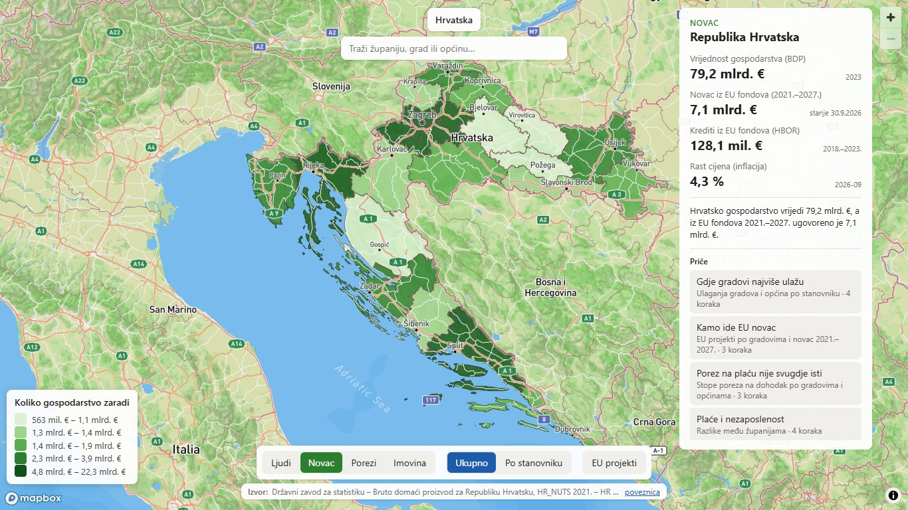
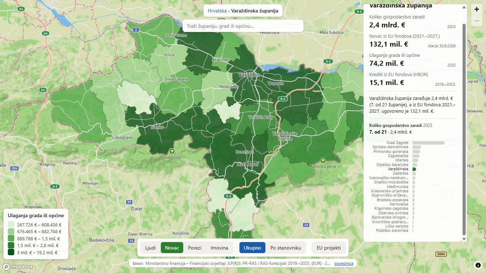
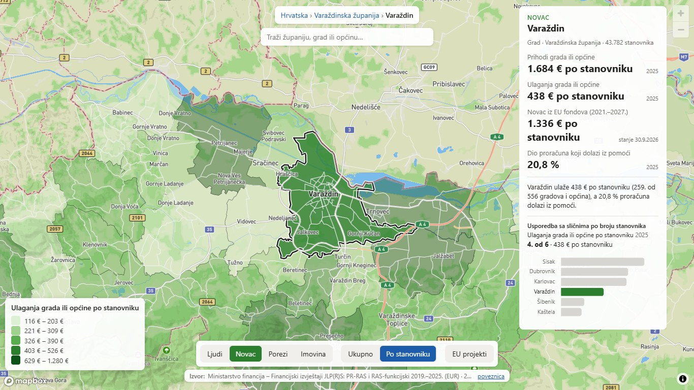
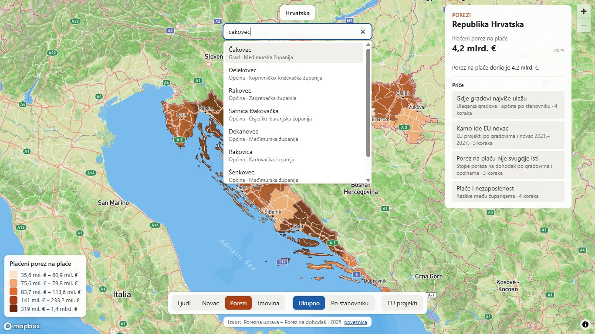
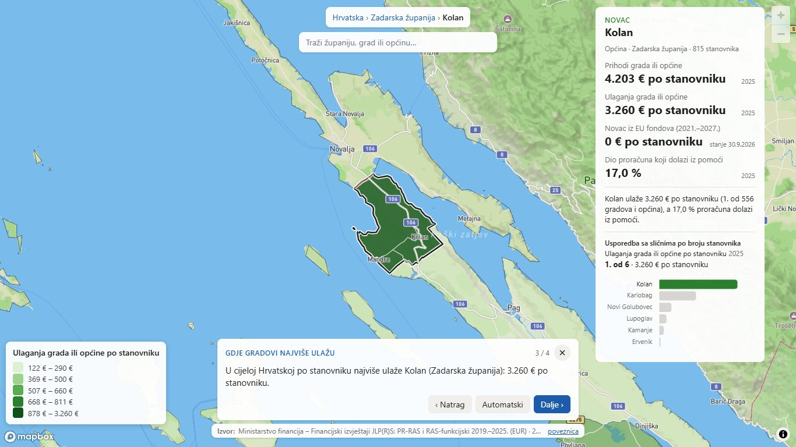
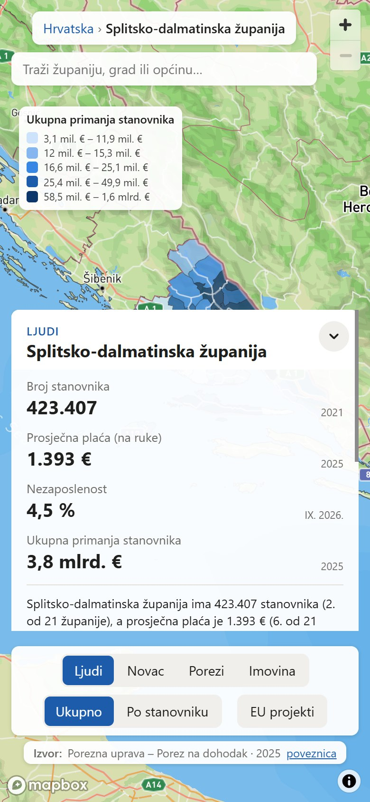

# Kompas Hrvatske – sučelje

Kompas Hrvatske je interaktivna karta koja na jednom mjestu pokazuje gospodarske i javne
podatke za cijelu Hrvatsku, 21 županiju i 556 gradova i općina. Namijenjen je građanima koji
žele razumjeti kako stoji njihov kraj, novinarima i istraživačima, te lokalnoj upravi i
investitorima koji uspoređuju područja.

Demo: <https://aborjan1.github.io/Kompas-Hrvatske/> · Pokretanje: [pokretanje.md](pokretanje.md)
· Podaci: [podaci-dokumentacija.md](podaci-dokumentacija.md) · Alati: [alati.md](alati.md)

## Raspored zaslona

| Dio | Gdje | Čemu služi |
| --- | --- | --- |
| **Putanja** | gore u sredini | Hrvatska › županija › grad. Klik na višu razinu vraća na nju. |
| **Pretraga** | ispod putanje | Traži županiju, grad ili općinu po imenu (vidi [Pretraga](#pretraga)). |
| **HR / EN** | pokraj pretrage | Jezik sučelja: hrvatski ili engleski (vidi [Engleska verzija](#engleska-verzija)). |
| **Karta** | cijeli zaslon | Područja obojana prema odabranom pokazatelju. Prelazak mišem pokazuje ime i vrijednost, klik odabire područje. |
| **Legenda** | dolje lijevo | Pet razreda boje s rasponom vrijednosti. |
| **Info panel** | stupac lijevo, ispod tema | Odabrano područje u karticama: Pregled (rečenica i do četiri broja) i Usporedba, a na razini Hrvatske Pregled i Priče. Stupac se zatvara jezičcem na rubu. |
| **Grafovi** | stupac desno | Grafovi teme za odabranu županiju, grad ili općinu. Novac: EU pozivi · Kamo ide novac · Kroz godine. Nabava: Veze · Kroz godine. Ljudi, Porezi i Imovina nemaju kartice jer je sadržaj jedan. Kartica bez podataka se ne prikazuje, a stupca nema ako područje nema grafova. Zatvara se jezičcem na rubu. Na ekranu užem od 1100 px ili nižem od 501 px grafovi su kartica info panela, s istim unutarnjim karticama. |
| **Teme i mjera** | na vrhu lijevog stupca | Teme Ljudi · Novac · Porezi · Imovina, prekidač „Ukupno / Po stanovniku” i sloj „EU projekti”. |
| **Izvor** | ispod tema | Izdavatelj, skup podataka i godina pokazatelja kojim je karta obojana, s poveznicom. |

## Tri razine

Aplikacija se otvara uvodnim letom s globusa na Hrvatsku. Let se može preskočiti gumbom
„Preskoči uvod” ili tipkom Esc.

**Hrvatska.** Županije su obojane prema pokazatelju teme. Info panel pokazuje brojke za
cijelu državu, a [priče](#priče) su u kartici Priče.

**Županija.** Klik na županiju (ili odabir u pretrazi) približi kartu. Njezini gradovi i
općine obojani su prema pokazatelju teme, a ostale županije su obična karta. Pregled pokazuje
brojke županije, a kartica Usporedba graf njezinog položaja među svih 21 županija. Klik na
stupac u grafu odabire tu županiju.

**Grad ili općina.** Klik na grad unutar županije. Pregled pokazuje vrstu (grad ili općina),
županiju, broj stanovnika i brojke teme, a kartica Usporedba tip općine i usporedbu s pet
gradova i općina najsličnijih po broju stanovnika iz cijele Hrvatske. Klik na sličan grad
odabire ga.

Kamera ostaje na odabranom području: može se zumirati i malo pomicati, a ako se odvuče predaleko, sama se vrati. Odzumiravanje ispod prikaza područja (stisak prstima, touchpad, kotačić ili „−”) vodi razinu više: s grada na županiju, sa županije na Hrvatsku.

## Teme i pokazatelji

Svaka tema ima svoju boju na karti i u sučelju. Brojke se mogu gledati ukupno ili po
stanovniku, gdje to ima smisla. Za pokazatelje bez vrijednosti po stanovniku (npr. stope u %)
prekidač je onemogućen.

| Tema | Karta: županije | Karta: gradovi i općine | Info panel (primjeri) |
| --- | --- | --- | --- |
| **Ljudi** | ukupna primanja stanovnika | ukupna primanja stanovnika | broj stanovnika, prosječna plaća, nezaposlenost |
| **Novac** | koliko gospodarstvo zaradi (BDV) | ulaganja grada ili općine | BDP, EU fondovi 2021.–2027., HBOR krediti, inflacija |
| **Porezi** | plaćeni porez na plaće | porez na plaću (niža stopa) | viša stopa, porez na nekretnine, porez na potrošnju |
| **Imovina** | prodane nekretnine | – | aktivne tvrtke i udruge (država) |

Ispod brojeva je jedna rečenica složena od stvarnih podataka, npr. *„Varaždin ulaže 438 € po
stanovniku (259. od 556 gradova i općina), a 20,8 % proračuna dolazi iz pomoći.”* Mjesto je
samo poredak (1 = najveća vrijednost), ne ocjena.

Gumb **EU projekti** uključuje krugove po gradovima i općinama: veličina kruga pokazuje
koliko je EU novca 2014.–2020. stiglo u to mjesto. Za odabrani grad panel pokazuje broj i
iznos projekata te pet najvećih.

## Pretraga

Pretraga pronalazi županije, gradove i općine i bez kvačica i uz tipfelere: „cakovec” pronalazi
Čakovec, „dakovo” i „djakovo” Đakovo. Uz svaki rezultat piše vrsta i županija, pa se razlikuju
mjesta istog imena (dva Otoka, dvije Svete Nedelje). Strelice biraju rezultat, Enter ga otvara,
Esc briše upit.

## Priče

Priče su kratki vođeni obilasci, napravljeni kao film. Pokreću se iz info panela na razini
Hrvatske. Paneli se sklone i karta zauzme cijeli ekran, preko nje se pojavi naslov priče, a
kamera se nagne u 3D. Zatim za svaku scenu boje se ugase, kamera polako odleti na područje,
boje se vrate, a rečenica scene pojavi se u oblačiću, riječ po riječ. Dok se čita, kamera
polako prilazi.

| Priča | Što pokazuje |
| --- | --- |
| Gdje gradovi najviše ulažu | ulaganja gradova i općina po stanovniku, od Hrvatske do najvećeg i najmanjeg |
| Kamo ide EU novac | EU projekti po gradovima i novac 2021.–2027. |
| Porez na plaću nije svugdje isti | najviša i najniža stopa poreza na dohodak |
| Plaće i nezaposlenost | razlike među županijama |

Priča ide sama: svaka scena traje dok se rečenica ne pročita, a traka koraka ispod oblačića
pokazuje koliko je ostalo. Kontrole su ‹ i › (scena natrag i naprijed), pauza i × za kraj, a
klik na korak otvara tu scenu. Na tipkovnici strelice lijevo i desno mijenjaju scenu, razmak
pauzira, a Esc završava priču. Na kraju se vraća pogled od prije priče. Uz smanjeno kretanje u
sustavu priča ne ide sama i kamera skače umjesto da leti. Brojevi u pričama računaju se iz
podataka, pa ostaju točni kad se podaci osvježe.

## Linkovi

Svaki pogled ima svoj link, npr. `#/zupanija/05?tema=novac&mjera=po-stanovniku` ili
`#/jls/04723?tema=porezi&mjera=ukupno`. Link poslan drugoj osobi otvara isti pogled, a tipke
Natrag i Naprijed u pregledniku idu po područjima.

## Engleska verzija

Prekidač **HR / EN** pokraj pretrage prebacuje cijelo sučelje na engleski: teme, nazive i
objašnjenja pokazatelja, rečenice, grafove, priče, legendu, oblačiće na karti i nazive mjesta
na podlozi. Brojevi se pišu na engleski način (€2.9 bn, 3.3%), a županije engleskim nazivima
(Split-Dalmatia County); pretraga i dalje pronalazi i hrvatske nazive.

Namijenjena je stranim ulagačima, EU partnerima i novinarima. Link na engleskom ima
`&lang=en` (npr. `#/jls/04090?tema=novac&mjera=ukupno&lang=en`), pa se može poslati pogled
koji se otvara na engleskom. Izbor se pamti u pregledniku; jezik se nikad ne pogađa iz jezika
preglednika, pa domaći korisnici uvijek dobiju hrvatski.

Nazivi gradova, općina, dobavljača i EU projekata te službeni nazivi skupova podataka ostaju
izvorni. Uvjeti EU poziva („Tko se može prijaviti”) prikazuju se kako pišu u planu, na
hrvatskom.

## Mobitel

- Info panel je ladica odozdo s tri visine: naziv i prvi broj, pola ekrana i gotovo cijeli
  ekran. Mijenja se strelicom ili povlačenjem prstom po naslovu. Kreće spuštena, da se odmah
  vidi karta, a kartice ostaju uz naslov dok se sadržaj lista. Grafovi su kartica ladice.
- Teme, mjera i izvor su u izborniku iza gumba s trenutnim odabirom (npr. „Porezi · Ukupno”).
- Legenda je tanka traka ispod tog gumba, a dodir je otvara. Putanja je uvijek u jednom retku.
- Mobitel položen na bok koristi lijevi stupac kao na računalu, samo uži, s grafovima u kartici.
- Za vrijeme priče panel se skloni, a kartica priče objašnjava što se vidi.
- Stranica se nikad ne skrola; skrolaju se samo paneli.

## Pristupačnost

- **Tipkovnica:** Tab ide redom putanja, pretraga, teme i mjera, EU projekti, izvor, pa
  karta. Svi gumbi imaju vidljiv fokus. Područje se bez miša odabire pretragom.
- **Čitači zaslona:** svi gumbi i polja imaju naziv; grafovi imaju i skrivenu tablicu s istim
  brojevima; promjena područja i scene priče se najavljuje.
- **Boje i kontrast:** svaka tema ima jednu boju u pet svjetlina, pa se razredi razlikuju i
  bez razlikovanja boja. Sav tekst ima kontrast barem 4,5 : 1.
- **Smanjeno kretanje:** ako je u sustavu uključeno, karta skače umjesto da leti, a priče se
  ne mijenjaju same.

## Prezentacija

Za prezentaciju bez čekanja mreže: u objavljenoj verziji dodaj `?zagrij` u adresu
(npr. `https://aborjan1.github.io/Kompas-Hrvatske/?zagrij`). Karta tada unaprijed preuzme
podlogu za cijelu Hrvatsku (oko 40 MB) u predmemoriju preglednika.

## Ograničenja

- Gradski prikaz Zagreba i Rijeke (ortofoto, gradski slojevi, 3D zgrade) je u izradi.
- Tema Imovina ima podatke samo za županije i cijelu Hrvatsku.
- EU projekti 2014.–2020. smješteni su u središte grada ili općine, ne na adresu, pa karta
  pokazuje jedan krug po mjestu.
- Pokazatelji imaju različite godine (npr. stanovništvo 2021., plaće 2025.); godina piše uz
  svaki broj.

Tehnički opis koda (stanje aplikacije, URL, priče, rečenice) je u
[web/README.md](../web/README.md).
